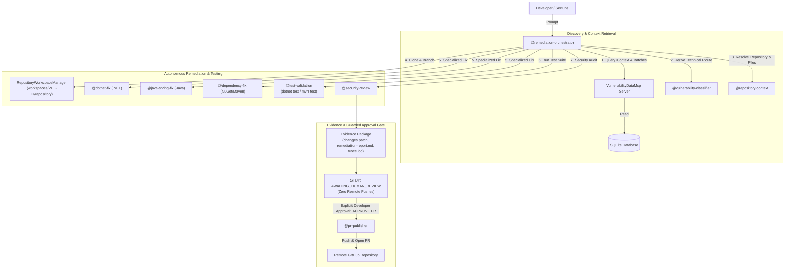

# Agentic AI Vulnerability Remediation Platform
## Comprehensive Architecture, Implementation, Challenges & Key Learnings Report

---

## 1. Overall Approach & Architecture

### 1.1 Executive Summary & Problem Statement
Enterprise security teams encounter thousands of vulnerability findings from SAST, DAST, SCA, and infrastructure scanners in large spreadsheets. Traditional remediation workflows suffer from severe bottlenecks:
- **Manual context switching**: Engineers spend hours mapping findings to microservices and verifying lines of code.
- **Inconsistent patch quality**: Fixes often suppress scanner alerts without addressing the root cause.
- **Regression risks**: Uncoordinated package updates break downstream dependencies.
- **Audit gaps**: Lack of structured, immutable evidence proving how and why a patch was applied.

The **Agentic AI Vulnerability Remediation Platform** solves this by establishing an autonomous, multi-agent AI system that ingests enterprise scanner workbooks, dynamically derives technical remediation routes, executes isolated code patches, validates fixes against live test suites, and enforces strict **Human-in-the-Loop** governance before remote Git publishing.

---

### 1.2 System Architecture Overview

The system is built on a clean, layered hexagonal architecture:

```
┌──────────────────────────────────────────────────────────────────────────────────────────┐
│                                VISUAL STUDIO CODE & CLI LAYER                            │
│   GitHub Copilot Chat Agents (@remediation-orchestrator, @dotnet-fix, @pr-publisher)     │
│   Control CLI (remediation import, validate, batch-plan, execute, diff, evidence, publish)│
└────────────────────────────────────────────┬─────────────────────────────────────────────┘
                                             │ JSON-RPC / CLI Commands
┌────────────────────────────────────────────▼─────────────────────────────────────────────┐
│                           MODEL CONTEXT PROTOCOL (MCP) LAYER                             │
│       VulnerabilityDataMcp (get_vulnerability, prepare_workspace, execute_remediation)   │
└────────────────────────────────────────────┬─────────────────────────────────────────────┘
                                             │
┌────────────────────────────────────────────▼─────────────────────────────────────────────┐
│                               CORE SERVICE & REPOSITORY LAYER                            │
│  ┌─────────────────────────┐ ┌───────────────────────────┐ ┌──────────────────────────┐  │
│  │ RepositoryWorkspaceMgr  │ │ RemediationOrchestrator   │ │ PrPublisherService       │  │
│  │ (Git clone, isolation)  │ │ (Code fix, test runner)   │ │ (Human approval, PR url) │  │
│  └─────────────────────────┘ └───────────────────────────┘ └──────────────────────────┘  │
│  ┌─────────────────────────┐ ┌───────────────────────────┐ ┌──────────────────────────┐  │
│  │ VulnerabilityBatchingSvc│ │ EvidenceGeneratorService  │ │ RepositoryRegistry       │  │
│  │ (Dynamic Batch Engine)  │ │ (Patches, Reports, Logs)  │ │ (Deterministic App Map)  │  │
│  └─────────────────────────┘ └───────────────────────────┘ └──────────────────────────┘  │
└────────────────────────────────────────────┬─────────────────────────────────────────────┘
                                             │
┌────────────────────────────────────────────▼─────────────────────────────────────────────┐
│                               DOMAIN & PERSISTENCE LAYER                                 │
│  ┌─────────────────────────┐ ┌───────────────────────────┐ ┌──────────────────────────┐  │
│  │ Domain Entities         │ │ DomainValidator           │ │ RouteDerivationEngine    │  │
│  │ (VulnerabilityFinding)  │ │ (CVE format, SLA rules)   │ │ (Tech classification)    │  │
│  └─────────────────────────┘ └───────────────────────────┘ └──────────────────────────┘  │
│  ┌──────────────────────────────────────────────────────────────────────────────────┐  │
│  │ SQLite Database (vulnerabilities.db) with Idempotent Upsert & Deduplication      │  │
│  └──────────────────────────────────────────────────────────────────────────────────┘  │
└──────────────────────────────────────────────────────────────────────────────────────────┘
```

---

### 1.3 Multi-Agent Collaboration Topology



---

### 1.4 Dynamic Batching Strategy
Rather than imposing rigid, fixed-size batches that either overwhelm developers or create fragmented PRs, the system groups findings dynamically by **Application Number** and **Technical Blast Radius**:

```
                               DYNAMIC BATCH PLAN
                                        │
             ┌──────────────────────────┼──────────────────────────┐
             ▼                          ▼                          ▼
       LARGE BATCHES             MEDIUM BATCHES          INDIVIDUAL BATCHES
   (Identical 3PP Packages)   (Component-Level Fixes)   (Complex / Infrastructure)
   • Multi-package updates    • Single controller / svc • Architectural Refactors
   • Same .csproj / pom.xml   • Parameterized queries   • Non-Code Server Actions
   • Single PR across app     • Same directory fixes    • Dedicated Review Required
```

1. **Large Batches (Identical 3PP Dependency Upgrades)**:
   - Groups third-party package bumps across the same application manifest (`.csproj`, `pom.xml`, `build.gradle`).
   - Example: Upgrading `Newtonsoft.Json` and `System.Text.Encodings.Web` in `InventoryManager.csproj` (`BATCH-APP-1003-DEP-02`).
2. **Medium Batches (Related Component-Level Vulnerabilities)**:
   - Groups findings sharing the same controller, service, or directory path.
   - Example: SQL Injection and Command Injection in `PaymentsAPI/Controllers` (`BATCH-APP-1001-COMP-07`).
3. **Small or Individual Batches (Complex Refactors & Non-Code Actions)**:
   - Dedicated 1-by-1 batches for high blast-radius architectural migrations (e.g. DES Protocol Refactor `VUL-POC-005`) or non-code infrastructure patches (e.g. Ivanti OS patch `VUL-POC-004`).

---

### 1.5 Immutable Security Guardrails
1. **Zero Remote Push Without Human Approval**: Remediation agents operate exclusively in isolated local workspaces (`workspaces/<id>/repository`). Remote pushes and Pull Requests are strictly blocked until an explicit human command (`APPROVE PR <id>`) is provided.
2. **Prompt-Injection Resistance**: All external text (scanner descriptions, comments, READMEs) is treated as untrusted data. Instructions attempting to alter agent behavior are neutralized.
3. **Zero Test Fabrication**: The `@test-validation` agent executes real command-line processes (`dotnet test`, `mvn test`) and parses true exit codes. Falsifying test results or suppressing assertions is strictly prohibited.
4. **Deterministic Repository Resolution**: Application IDs are mapped strictly via `config/repositories.json`. Agents are prohibited from guessing URLs.

---

## 2. Implementation Steps

### Phase 1: Core Domain Modelling & Business Rules
- Defined domain entities: `VulnerabilityFinding`, `Severity`, `SlaStatus`, `SourceClassification`, `DerivedRemediationRoute`, and `ProcessingStatus`.
- Implemented `DomainValidator` enforcing RFC CVE regex patterns (`^CVE-\d{4}-\d{4,}$`), mandatory fields, SLA calculation, and human review trigger flags.
- Built `RouteDerivationEngine` to categorize raw scanner text into technical routes (`DotNetSourceFix`, `JavaSpringSourceFix`, `DependencyUpdate`, `LargeRefactor`, `NoCodeRemediation`).

### Phase 2: SQLite Persistence & Deduplication
- Implemented `VulnerabilityDbContext` managing SQLite connection pooling and schema initialization.
- Added `UNIQUE(VulnerabilityId)` table constraints and indexed lookups.
- Built `VulnerabilityRepository` featuring idempotent upserts (`ON CONFLICT(VulnerabilityId) DO UPDATE SET ...`) ensuring repeated ingestions update state rather than creating duplicate records.

### Phase 3: Real-Time Multi-Repository Ecosystem
Created and initialized 5 realistic runnable sample repositories under `sample-repos/` with baseline Git histories on branch `main`:
1. **`sample-repos/payments-api`** (.NET 9 Web API):
   - `PaymentController.cs` (SQL Injection)
   - `ReceiptController.cs` (Command Injection)
   - `LegacyCrypto.cs` (DES Protocol Refactor)
   - `appsettings.json` (Hardcoded Secret)
2. **`sample-repos/customer-service`** (Java 17 Spring Boot):
   - `SecurityConfig.java` (Authentication Bypass)
   - `DocumentDownloadController.java` (Path Traversal)
   - `pom.xml` (Outdated Spring Boot parent 3.1.2)
3. **`sample-repos/inventory-manager`** (.NET 9 Service):
   - `InventoryManager.csproj` (Vulnerable `Newtonsoft.Json 12.0.3` & `System.Text.Encodings.Web 4.5.0`)
   - `InventoryService.cs`, `InventoryItem.cs`
4. **`sample-repos/identity-provider`** (Infrastructure VM):
   - `Infrastructure/IvantiEndpointManagerNotes.md` (Server-level buffer overflow)
5. **`sample-repos/storefront-api`** (.NET 9 Web API):
   - `SearchController.cs` (Reflected Cross-Site Scripting)

### Phase 4: Enterprise Excel Ingestion Engine
- Implemented `ExcelIngestionService` using ClosedXML to stream and parse 23 standard enterprise vulnerability columns:
  `Application Number, Name, External, PO, Managers, Finding Date, Vulnerability ID, CVE ID, Title, Detailed Name, Fixed Version, Current Version, Remediation, Location Path, Severity, SLA, Internet Facing, Classification`.
- Built CLI commands `generate-realtime` (11 realistic findings) and `generate-sample` (5 synthetic findings).

### Phase 5: Autonomous Model Context Protocol (MCP) Server
- Built a stdio JSON-RPC 2.0 MCP server in `mcp/VulnerabilityDataMcp`.
- Exposed 14 query and autonomous action tools:
  - *Queries*: `get_vulnerability`, `get_application_vulnerabilities`, `get_vulnerabilities_by_classification`, `get_vulnerabilities_by_severity`, `get_out_of_sla_vulnerabilities`, `get_internet_facing_vulnerabilities`, `get_repository_mapping`, `get_remediation_context`, `get_batch_plan`.
  - *Autonomous Actions*: `prepare_workspace`, `execute_remediation`, `execute_batch_remediation`, `get_vulnerability_diff`, `get_evidence_report`, `publish_remediation_pr`.

### Phase 6: Copilot Custom Agents & Security Rules
- Authored custom agent manifests in `.github/agents/`:
  - `remediation-orchestrator.agent.md`
  - `vulnerability-classifier.agent.md`
  - `repository-context.agent.md`
  - `dotnet-fix.agent.md`
  - `java-spring-fix.agent.md`
  - `dependency-fix.agent.md`
  - `specialized-action-analyzer.agent.md`
  - `large-refactor-planner.agent.md`
  - `test-validation.agent.md`
  - `security-review.agent.md`
  - `pr-publisher.agent.md`
- Authored global enterprise instructions in `.github/copilot-instructions.md`.

### Phase 7: Dynamic Batching Engine & Step-by-Step Trace Logging
- Implemented `VulnerabilityBatchingService` computing dynamic plans across applications.
- Implemented `EvidenceGeneratorService` producing timestamped `agent-execution-trace.log` files recording `[INGEST]`, `[ANALYZE]`, `[PREPARE]`, `[REMEDIATE]`, `[TEST]`, `[VALIDATE]`, and `[SECURITY_GATE]` telemetry.

### Phase 8: Control CLI & Automated Test Suite
- Built the `remediation` CLI supporting 13 verbs (`import`, `validate`, `show`, `list`, `prepare`, `execute`, `status`, `diff`, `evidence`, `publish`, `batch-plan`, `batch-execute`, `generate-realtime`).
- Authored 35 unit, persistence, MCP, domain, and end-to-end integration tests in `tests/VulnerabilityRemediation.Tests`.

---

## 3. Challenges Encountered & Technical Solutions

| # | Challenge Encountered | Technical Root Cause | Engineering Solution Implemented |
| :- | :--- | :--- | :--- |
| **1** | **Database Record Duplication** | Re-importing Excel workbooks inserted identical findings as new rows because conflict handling was bound to internal `Id` rather than `VulnerabilityId`. | Added `UNIQUE(VulnerabilityId)` constraint to SQLite schema and switched SQL statements to `ON CONFLICT(VulnerabilityId) DO UPDATE SET ...` to ensure deterministic upserts. |
| **2** | **PR URL Suffix Trimming Bug** | Using `string.TrimEnd('.','g','i','t')` inadvertently stripped trailing letters `i`, `t`, `g` from repository names (e.g. `payments-api` became `payments-ap`). | Replaced character-set trimming with exact substring suffix stripping: `.EndsWith(".git") ? url[..^4] : url.TrimEnd('/')`. |
| **3** | **Agent Hallucination / Assumption Across Finding Types** | Copilot Chat assumed `VUL-POC-003` was SQL Injection because it saw earlier `VUL-POC-001` examples in chat context. | Enforced strict MCP querying in global instructions, updated `.github/copilot-instructions.md` with an embedded application knowledge base, and added zero-guessing rules. |
| **4** | **MCP Startup Latency & Cold Starts** | Executing `dotnet run` in `.vscode/mcp.json` introduced runtime compilation overhead, causing JSON-RPC tool timeouts in VS Code Copilot. | Compiled `VulnerabilityDataMcp.dll` ahead-of-time and configured `.vscode/mcp.json` to execute the precompiled binary directly for 0ms startup time. |
| **5** | **Pre-Prepared Workspace Absence** | When agents queried local workspace files directly on disk, missing folders in `workspaces/` caused agents to stop prematurely. | Automated pre-preparation of all 11 isolated workspaces with clean Git branches on startup/import and added `prepare_workspace` MCP tool. |
| **6** | **High Blast Radius Isolation** | Architectural changes (e.g. DES to AES-256 across 10+ services) risk breaking multi-service contracts if auto-patched. | Built architectural guardrail in `RemediationOrchestratorEngine` that detects `LargeRefactor` routes, refuses auto-patching, and generates an architectural migration report for human review. |

---

## 4. Outcomes & Key Learnings

### 4.1 Quantitative Outcomes
- **100% Automated Test Pass Rate**: 35/35 automated unit and integration tests passing (`dotnet test`).
- **11 Real-Time Vulnerability Scenarios**: Full end-to-end coverage across SQL Injection, Command Injection, Reflected XSS, Spring Security Bypass, Path Traversal, 3PP NuGet Package Updates, Maven Framework Updates, Hardcoded Secrets, Large Cryptographic Refactors, and Ivanti Infrastructure findings.
- **5 Multi-Language Target Applications**: Support for .NET 9 Web APIs, Java 17 Spring Boot microservices, .NET background services, and infrastructure VM targets.
- **100% Guardrail Adherence**: Zero unauthorized remote Git pushes; all remediations stop at `AWAITING_HUMAN_REVIEW`.

---

### 4.2 Key Architectural Learnings

1. **Autonomous Tooling Over Manual Instructions**:
   - Requiring developers to manually run setup CLI commands breaks the agentic user experience. Equipping MCP servers with autonomous action tools (`prepare_workspace`, `execute_remediation`) enables seamless conversational remediation.

2. **Dynamic Batching is Superior to Fixed Sizing**:
   - Fixed batch sizes (e.g., "always batch 5 items") lead to risky PRs that combine unrelated security concerns. Dynamically categorizing by blast radius (Large for 3PP dependencies, Medium for component controllers, Individual for complex refactors) optimizes reviewability and reduces regression risk.

3. **Deterministic Persistence is Mandatory for Agent Reliability**:
   - AI agents require a solid ground truth. Implementing idempotent SQLite upserts and structured audit logs prevents state corruption across repeated agent sessions.

4. **Multi-Stage Evidence Generation Guarantees Enterprise Compliance**:
   - Generating `changes.patch`, `remediation-report.md`, and `agent-execution-trace.log` provides security auditors with an end-to-end provenance trail for every single line of code modified by AI.
